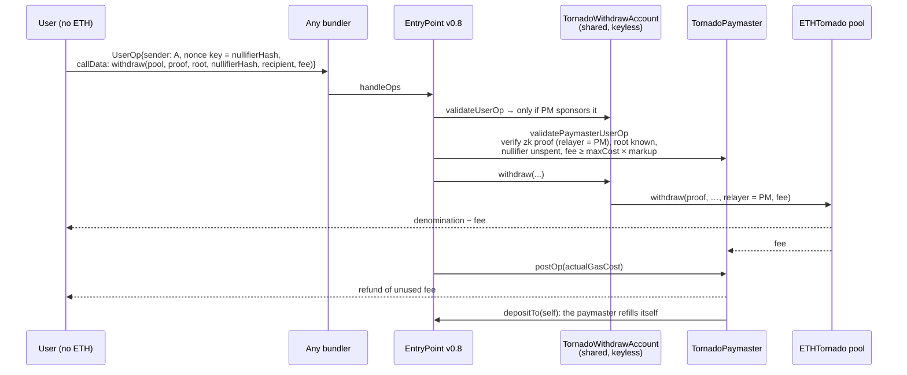

# tornado-core-v3

The Tornado Cash core contracts, ported to Solidity 0.8.37 / Cancun, with three new features:

- **gasless withdrawals through ERC-4337**: no relayer network
- **Permit2 / EIP-2612 deposits**: the deposit signature commits to the note
- **OP Stack fee quoting** for Base

The original circuit and its **2020 trusted-setup ceremony** are unchanged. The test suite generates
real Groth16 proofs with the ceremony proving key and verifies them against the exact `Verifier`
bytecode deployed on Ethereum mainnet in 2020. It also runs the same proofs through the original
2021 contracts to compare gas.

> Educational / portfolio project. Not audited. Tornado Cash was delisted by OFAC in March 2025,
> but running a mixer or relayer can still carry legal risk depending on where you are. Deploy to
> testnets.

## What changed vs. tornado-core

| Area | tornado-core (2021) | here |
|---|---|---|
| Compiler / tooling | solc 0.7.6, Truffle, Mocha | solc 0.8.37, Foundry, fuzz + invariant + fork tests |
| Reentrancy guard | storage `ReentrancyGuard` (OZ 3.4) | EIP-1153 transient `ReentrancyGuardTransient` (OZ 5.7) |
| Errors | revert strings | custom errors |
| `levels`, `denomination`, `verifier`, `token` | storage | `immutable` |
| Merkle hashing | ABI call through a `public` function, both inputs range-checked per level | one assembly `staticcall` per permutation; only the leaf is range-checked |
| Initial root | `zeros(levels - 1)` (wrong, but harmless) | `zeros(levels)`, the real empty-tree root |
| Hostile recipient (reverts, burns gas, return bomb) | withdrawal reverts, relayer pays for nothing, note stays reusable | payout deferred to `pendingPayouts`; withdrawal succeeds |
| ERC20 deposits | `approve` + `deposit` | + `depositWithPermit` (EIP-2612, front-run safe) and `depositWithPermit2` (witness-bound, anyone can submit) |
| Fee-on-transfer tokens | silently make the pool insolvent | rejected via balance-delta check |
| Withdrawing to a fresh address | needs an off-chain relayer | any ERC-4337 bundler + `TornadoPaymaster`; gas paid from the note |
| L2 fees | `gas × gasPrice` | `TornadoFeeQuoter` adds the OP Stack L1 data fee |
| Verifier | 2020 ceremony `Verifier.sol` | kept unchanged for pools, plus `Groth16Verifier`: same key, assembly, ERC-7562-safe |

**ABI compatible.** `deposit`, `withdraw`, `isSpent`, `isSpentArray`, `isKnownRoot`, `getLastRoot`,
`zeros`, `hashLeftRight` and the `Deposit` / `Withdrawal` events are unchanged, so tornado-cli-style
clients and note strings (`tornado-eth-0.1-8453-0x…`) keep working.

## Gas vs. the original

Cold calls with the same hasher, same verifier, same proof, and identical account state
(`test/GasComparison.t.sol` → `snapshots/GasComparisonTest.json`):

| | tornado-core | this repo | Δ |
|---|---:|---:|---:|
| ETH deposit | 941,108 | 918,103 | −23,005 (−2.4%) |
| ETH withdraw (ceremony verifier) | 380,109 | 373,766 | −6,343 (−1.7%) |
| ETH withdraw (`Groth16Verifier`) | 380,109 | 355,844 | −24,265 (−6.4%) |
| ERC20 deposit (includes the new balance-delta check) | 975,338 | 950,898 | −24,440 (−2.5%) |
| ERC20 withdraw | 373,672 | 363,034 | −10,638 (−2.8%) |

The savings are modest. About 700k of a deposit (76%) is 40 calls to the MiMC permutation, and about 220k of a
withdraw is BN254 precompiles (one pairing plus six scalar multiplications). Neither changes without
changing the circuit. On Base, a full sponsored withdrawal (about 1M gas including validation)
costs a few cents at October 2026 gas prices.

## Gasless withdrawals with ERC-4337

The classic Tornado problem: the recipient is a fresh address with 0 ETH, so it cannot pay gas, and
paying from a funded address would link the two. tornado-core solved this with a network of
relayers. Here, any ERC-4337 bundler does the job.



Design points:

- **Authorisation comes from the proof.** The proof binds `recipient`, `relayer = paymaster` and
  `fee`, so a UserOperation copied from the mempool cannot be redirected. The account has no owner
  and no signature.
- **Nonce lanes.** The shared sender uses nonce key `uint192(nullifierHash)`. Withdrawals don't
  queue behind each other, and a second UserOperation for the same note fails nonce validation.
- **ERC-7562 (bundler validation rules).** The 2020 verifier calls precompiles with
  `staticcall(sub(gas(), 2000), …)`, and bundlers reject `GAS` unless a `*CALL` follows it
  immediately. So the paymaster validates with `Groth16Verifier`, which uses the same ceremony key
  rewritten in assembly. A test scans both bytecodes and shows the old one fails. Reading the pool's
  storage during validation requires the paymaster and the account to be staked (STO-033;
  `addStake` / `addAccountStake`).
- **No free griefing.** An op that passes validation must not revert during execution, or the
  paymaster pays gas and earns nothing. Every way a user could cause that is closed and tested:
  - an invalid proof, spent note, unknown root, or fee above the denomination is rejected during validation
  - a `callGasLimit` / `postOpGasLimit` too low to finish is rejected by enforced floors
  - a recipient that reverts, burns gas, or **return-bombs** (reverts with 300 KB of return data) gets a deferred payout (`SafeSend` never copies return data)
  - a postOp that runs out of gas on the worst path is covered by `POST_OP_GAS` sized from the measured worst case (≈98k)

  What remains is a race: the same note withdrawn directly between validation and inclusion. To do
  it, the attacker spends their own note and pays for their own transaction.
- **ETH pools only.** The fee arrives in the pool's asset, and pricing tokens would need an oracle.

## Base / OP Stack

- `TornadoFeeQuoter.quoteRelayerFee` = L2 execution + `GasPriceOracle.getL1FeeUpperBound` + margin.
  Since EIP-4844 the L1 part is small on Base (around 2% of a withdrawal in October 2026), but it
  follows L1 blob fees and can spike. An L1-blind relayer formula loses money when that happens.
- `l1PreVerificationGas` gives 4337 clients the extra `preVerificationGas` that bundlers on OP chains
  charge for L1 data. That amount is part of `maxCost`, so the paymaster's fee check already covers it.
- Canonical addresses used (all present on Base and Base Sepolia, checked in the fork test):
  EntryPoint v0.8 `0x4337084D9E255Ff0702461CF8895CE9E3b5Ff108`, Permit2
  `0x000000000022D473030F116dDEE9F6B43aC78BA3`, GasPriceOracle `0x420…0F`.

## Layout

```
src/
  MerkleTreeWithHistory.sol   incremental MiMC tree, 30-root history
  Tornado.sol                 core pool (abstract)
  ETHTornado.sol              native-asset pool, deferred payouts
  ERC20Tornado.sol            token pool, EIP-2612 + Permit2 witness deposits
  aa/TornadoPaymaster.sol     ERC-4337 paymaster: validates proofs, self-refilling
  aa/TornadoWithdrawAccount.sol  shared keyless 4337 sender
  l2/TornadoFeeQuoter.sol     L1-data-fee-aware fee quotes
  verifier/Verifier.sol       2020 ceremony verifier, byte-for-byte (solc 0.5.17)
  verifier/Groth16Verifier.sol  same key, assembly, ERC-7562-safe
  hasher/MiMCSpongeDeployer.sol  circomlib MiMCSponge(220) bytecode
  libraries/SafeSend.sol      ETH send that can't be return-bombed
test/
  legacy/                     original tornado-core contracts (import paths only changed), for gas comparison
  fixtures/permit2.runtime.hex  canonical Permit2 bytecode from Base Sepolia
  *.t.sol, invariant/         72 tests, see below
js/                           prover used via FFI (tornado-cli's exact library versions)
script/Deploy.s.sol           full deployment (Base Sepolia defaults)
```

## Running it

```sh
git clone --recursive <this repo> && cd tornado-core-v3
cd js && npm ci --ignore-scripts && node download-keys.js && cd ..   # ~34 MB, sha256-pinned
forge test                                                           # ~1 min cold, proofs are cached in js/.cache
BASE_SEPOLIA_RPC_URL=https://sepolia.base.org forge test             # + end-to-end on a Base Sepolia fork
```

The first run generates each Groth16 proof (about 10 s each) with the 2020 proving key, via
`js/ffi.js` and the same circomlib / snarkjs / websnark commits tornado-cli shipped with. Later runs
use the cache.

What's covered:

- **Verifier:** real proofs accepted by both verifiers; fuzzed tampering of each public input and
  each proof word rejected, with both verifiers agreeing; ERC-7562 bytecode scan.
- **Merkle tree:** differential fuzzing against an independent JS tree; zero-value chain; the
  30-root history window; full tree; field bounds.
- **Pools:** deposit and withdraw with real proofs; double spend; recipient, relayer, fee or root
  swapped (front-running); refunds; hostile recipients (rejecting, gas-burning, return bomb,
  reentrant); fee-on-transfer token; EIP-2612 front-run; Permit2 witness binding, replay and wrong
  token.
- **4337:** sponsored withdrawal end to end; two withdrawals in one bundle; replay; every
  validation rejection; hostile recipients cannot grief the paymaster.
- **Invariants:** solvency, no forged or double-spent withdrawals, latest root always known (random
  deposits, real withdrawals and replays, forged proofs).
- **Base Sepolia fork:** the canonical EntryPoint, Permit2 and GasPriceOracle, with a sponsored
  withdrawal and a Permit2 deposit against them.

### Deploy

```sh
forge script script/Deploy.s.sol --rpc-url base_sepolia --account <keystore> --broadcast --verify
```

This deploys the hasher, both verifiers, `TornadoFeeQuoter`, ETH pools (0.001 / 0.01 / 0.1), a USDC
pool with Permit2, and the paymaster (funded, with both entities staked). Pools use the 2020
ceremony verifier, the audited one. The new assembly verifier only gates what the paymaster
sponsors, so a bug in it could waste paymaster gas but could not move pool funds. Total cost on
Base Sepolia: about 0.0002 ETH. Configuration is in the script header.

## Known limitations

- Not audited. `Groth16Verifier`, the paymaster and the deferred-payout logic are new code.
- Proofs are not bound to a pool address or chain ID. This is a property of the original circuit:
  the nullifier sets are separate, so it isn't a double-spend, but a proof can be replayed on
  another pool whose root history contains the same root. Fixing it needs a circuit change.
- MiMC + Pedersen stay, because changing to Poseidon means a new circuit and a new trusted setup.
  That would be the natural next project.
